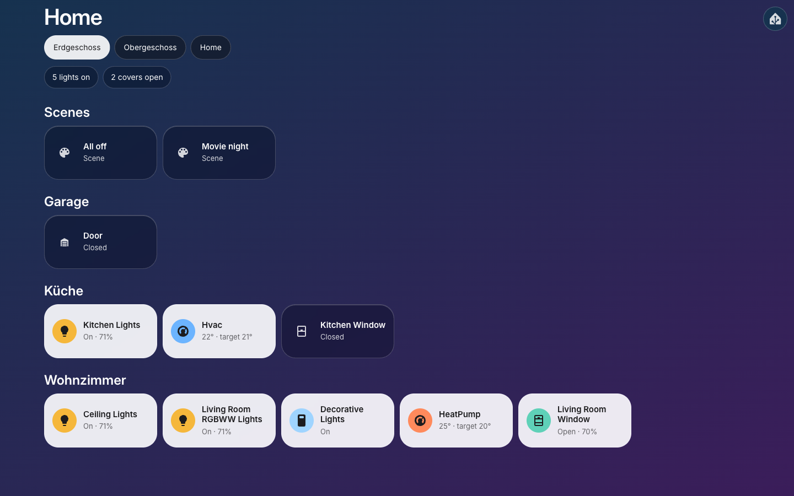
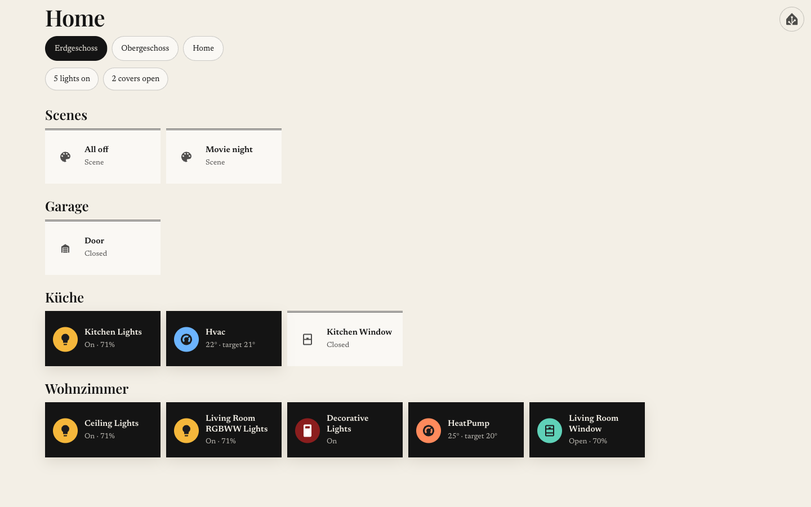
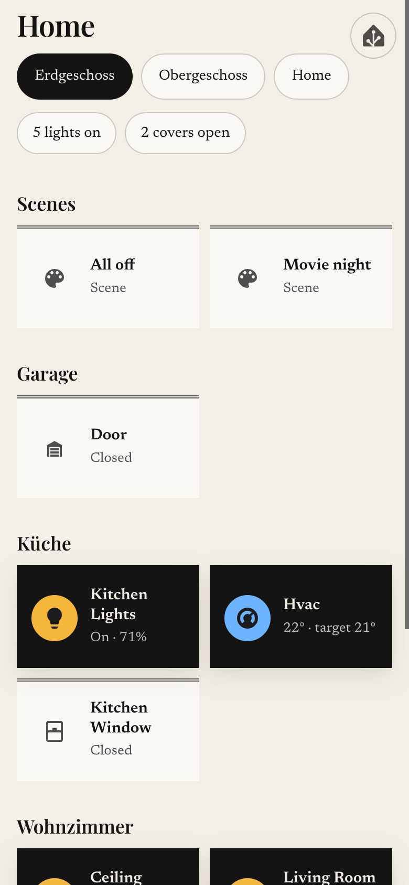
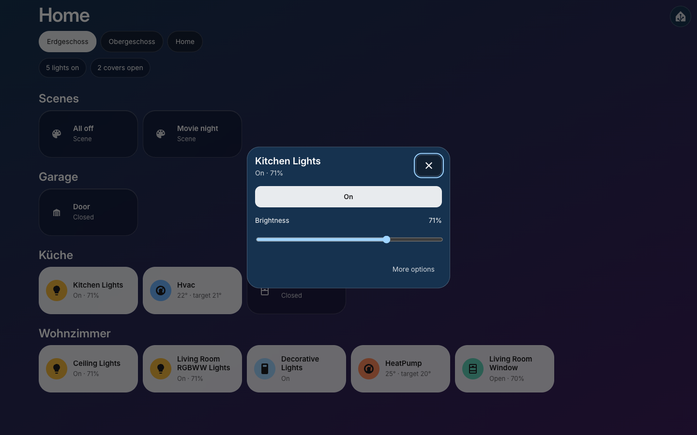
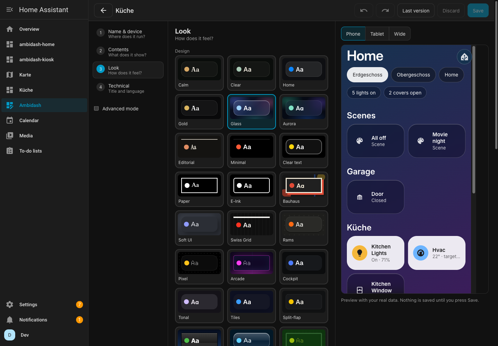
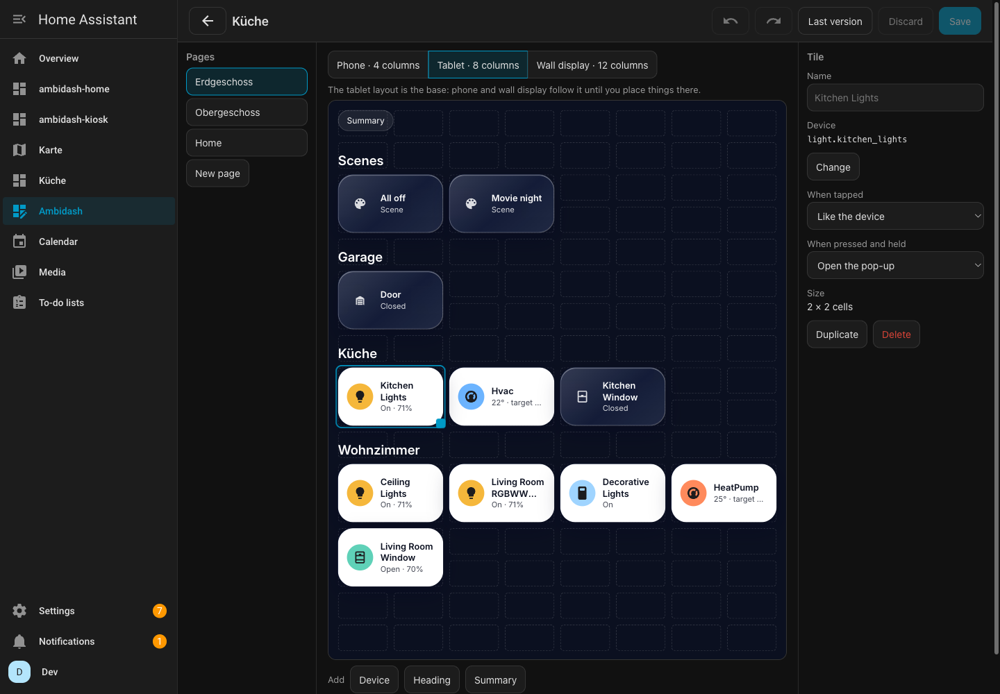

# Ambidash

**Ein Dashboard für Home Assistant, das sich aus deinen Etagen, Bereichen und Geräten selbst baut.** Helle Kacheln, 36 Designs in hell und dunkel, sofortige Rückmeldung, und es läuft gleich im Browser, in der HA-App auf dem Handy und auf dem Wandtablet.

> **Beta 0.1.** Lichter, Schalter, Klima, Rollläden, Mediaplayer und Szenen, mit Pop-ups, 36 Designs (dieselben wie in [Ambiframe](https://github.com/diggi-85/ambiframe)), einem Studio mit Einrichtungsassistent, Design-Galerie und Layout-Editor. Der Ruhemodus folgt. Das ist eine Beta: rechne mit Ecken und Kanten und sichere vorher dein System. Braucht Home Assistant **2026.11** oder neuer.

<p align="center"><a href="README.md">English</a> · <b>Deutsch</b></p>

<p align="center"></p>

## Was du bekommst

- **Ein Dashboard ohne Einrichtung:** Etagen → Bereiche → Kacheln, gebaut aus dem, was Home Assistant schon weiß. Versteckte und Diagnose-Entitäten bleiben draußen; Geräte ohne Bereich erscheinen zuletzt unter „Ohne Bereich“.
- **Szenen zuerst:** Szenen bekommen eine eigene Zeile ganz oben, egal zu welchem Bereich sie gehören.
- **Kacheln, die sofort reagieren:** Antippen schaltet Licht, Schalter und Rollladen, aktiviert eine Szene, startet oder pausiert Medien. Die Kachel zeigt den neuen Zustand gleich und korrigiert sich, wenn Home Assistant widerspricht.
- **Langes Drücken (oder Umschalt+Eingabe) öffnet den Detaildialog von Home Assistant.** Tore und Garagentore öffnen immer den Dialog, statt auf einen einzelnen Tipp zu fahren.
- **Zusammenfassung oben:** Lichter an, Rollläden offen, Wiedergaben.
- **36 Designs, hell und dunkel, dieselben wie in Ambiframe** (jedes Design hört auch auf seinen Ambiframe-Namen: `design: ruhig` = `design: calm`; die Schriften sind die von Ambiframe, liegen der Integration bei und laden erst, wenn ein Design sie braucht; wo eine Ambiframe-Farbe auf Kacheln nicht lesbar wäre, ist sie verschoben und das steht in `docs/design-abgleich.md`). Darunter: *Calm* (Serifen, warm), *Clear* (schlicht, Salbei), *Home* (helle Kacheln wie in Apple Home), zwölf aus Ambiframe (*Gold*, *Glass*, *Aurora*, *Editorial*, *Minimal*, *Clear text* mit großer, kontrastreicher Schrift, *Paper*, *E-Ink* ganz ohne Animation, *Bauhaus*, *Soft UI*, *Swiss Grid*, *Rams*) und *Seasons*, das sich nach dem Datum richtet: Weihnachten, Silvester, Valentinstag, Ostern, Halloween, sonst Frühling, Sommer, Herbst oder Winter. Hell/Dunkel folgt Home Assistant.
- **Mach es zu deinem:** ein Bild, eine Farbe oder ein Verlauf hinter den Kacheln (auf Wunsch abgedunkelt und weichgezeichnet), Kacheln aus Glas, mit Linie oder flach, fünf Farbpaletten über jedem Design (Nordisch, Vampir, Mocha, Retro, Nachtstadt) und eine eigene Akzentfarbe. Der Textkontrast wird für jede Kombination geprüft.
- **Fotos im Wechsel:** die Bilder eines Medienquellen-Ordners (eigene, Immich, Synology …) blenden hinter den Kacheln ineinander über, oder freie Platzhalter-Fotos (Wikimedia „Bild des Tages“, NASA, gemeinfreie Gemälde, Lorem Picsum, Bing), die Home Assistant selbst abruft und ausliefert; deine Geräte melden sich bei diesen Seiten nicht, und ein Schalter stoppt jeden Abruf.
- **Ein Studio in der Seitenleiste:** ein **Einrichtungsassistent** mit vier Schritten (Name und wo es läuft: in Home Assistant oder auf einem Wandtablet, das den Bildschirm füllt · Inhalte: welche Bereiche und Gerätearten, und das Layout · Aussehen · Titel und Sprache) mit Zurück/Weiter und ein **Erweitert-Modus** (Schalter in der Schrittliste, pro Gerät gemerkt), der alle Optionen als bearbeitbares JSON und als YAML-Dashboard zeigt. Dashboards anlegen, Design, hell/dunkel, Farbpalette und Kachelstil wählen und jede Änderung in einer Live-Vorschau mit deinen echten Daten sehen (Handy, Tablet oder breit). Rückgängig und Wiederholen, **Speichern** (Strg/⌘+S), **Letzte Fassung** als Rückweg nach einem Speichern, und ein Klick legt ein Dashboard in die Seitenleiste. Die Aussehen-Seite zeigt alle Designs als **Galerie** kleiner Vorschauen in ihren eigenen Farben und Schriften (hell oder dunkel wie im Dashboard) und setzt auch deine eigene **Akzentfarbe** und den **Hintergrund**: keiner, eine Farbe, ein Verlauf, ein Bild oder Fotos (ein Medienordner und/oder freie Platzhalter-Fotos, mit Abdunkeln, Unschärfe, Wechselzeit und Bildnachweis). Offene Dashboards, auch auf Wandtablets, folgen einem Speichern sofort. **Aus Bereichen erzeugen** macht aus deinen Etagen und Bereichen ein eigenes Layout: eine Seite je Etage auf einem Raster mit 4 Spalten auf dem Handy, 8 auf dem Tablet und 12 auf einem Wanddisplay (was du auf einem Gerät nicht platziert hast, folgt dem Tablet-Layout). **Layout bearbeiten** öffnet den Layout-Editor: Kacheln, Überschriften und die Zusammenfassung auf dem Raster ziehen, die Größe mit der Ecke ändern, mehrere mit Umschalt/⌘-Klick wählen, mit den Pfeiltasten verschieben (mit Umschalt die Größe), duplizieren (⌘D), löschen, Geräte per Suche hinzufügen, Seiten anlegen. Handy, Tablet und Wanddisplay bekommen je ein eigenes Layout, sobald du dort etwas änderst. **Ändern** tauscht das Gerät einer Kachel (Name, Platz und Aktionen bleiben), und je Kachel wählst du, was **Tippen** und **Gedrückthalten** tun: das Ambidash-Pop-up, den Dialog von Home Assistant oder nichts (Tippen kann auch beim Gerät bleiben: schalten, abspielen, aktivieren). Das **Pop-up** hat die Bedienelemente des Geräts: Helligkeit und Farbtemperatur beim Licht, Zieltemperatur und Modus beim Thermostat, Auf/Stopp/Zu und Position beim Rollladen, Titeltasten und Lautstärke beim Player, Schalter und Szenen; Regler wirken beim Loslassen, und *Mehr Optionen* führt zum Dialog von Home Assistant.
- **Home-Assistant-Karten in deinem Layout:** Im Layout-Editor eine **Karte** hinzufügen und das YAML einer beliebigen Home-Assistant-Karte einfügen: Mushroom, Bubble Card oder Button-Card, oder die eingebauten Karten Tile, Entities oder Thermostat. Ambidash baut sie mit der Karten-Engine von Home Assistant selbst, also funktionieren eigene Karten, Templates und Aktionen wie in einem normalen Dashboard, und die Karte übernimmt Farben, Ecken und Schrift des Designs. Eigene Karten müssen als Dashboard-Ressourcen installiert sein; in der Vorschau des Studios erscheint eine Karte als Platzhalter, im Dashboard selbst sieht man sie. Um mit dem anzufangen, was du schon hast, macht **Von einem Dashboard importieren** (Schritt Inhalte) aus den Ansichten eines bestehenden Dashboards Seiten: Tile-, Licht-, Thermostat- und Button-Karten von Geräten, Entities-Karten von Geräten und Überschriften-Karten werden zu Kacheln und Überschriften, aber nur, wenn nichts verloren geht (eine andere Tipp-Aktion, ein Symbol oder Features lassen die Karte, wie sie ist); jede andere Karte, auch Stacks und Grids, wird so eingebettet, wie sie ist, und ihr Größenhinweis bestimmt ihre Größe. Badges werden nicht importiert, und das importierte Dashboard bleibt unangetastet. zwei Spalten auf dem Handy, breitere Kacheln auf großen Bildschirmen, optional Vollbild für Wandtablets (läuft in der HA-App und in Fully Kiosk, ohne Kiosk-Plugin). Die Bedingungen der Karten kommen mit: Die `visibility` einer Karte und eine Conditional-Karte werden zu den Bedingungen des Elements (Zustand, Zahl, und/oder), solange Ambidash genau dasselbe sagen kann (eine Bildschirmgröße oder ein Benutzer geht nicht, dann behält die Karte ihre eigene Sichtbarkeit).
- **Uhr- und Wetter-Widgets:** Im Layout-Editor eine **Uhr** (Zeit und Datum in der Uhrschrift des Designs; 12 oder 24 Stunden, Sekunden und Datum sind Optionen) oder ein **Wetter**-Widget (wie es jetzt ist und die Vorhersage der nächsten Tage, für jede Wetter-Entität) hinzufügen. Uhr- und Wetter-Karten eines importierten Dashboards werden zu diesen Widgets, wenn das Widget alles kann, was sie konnten.
- **Ruhemodus:** Nach ein paar Minuten ohne Berührung zeigt das Dashboard eine ruhige Uhr mit Datum, auf Wunsch mit Wetter, über dem abgedunkelten Hintergrund (die Foto-Show läuft dahinter weiter). Eine Berührung, eine Taste oder das Mausrad weckt es wieder; die erste Berührung weckt nur und schaltet nie etwas. Standardmäßig gilt er für Tablet und Wand-Display, die Uhr wandert gegen Einbrennen jede Minute ein paar Pixel, und solange ein Pop-up offen ist, startet nichts. Du kannst auch sagen, wann er starten darf: nur zu einer Tageszeit oder nicht, solange ein Mediaplayer spielt (im Erweitert-Modus beliebige Bedingungen); gilt das nicht mehr, endet er von selbst. Einrichten im Studio, Schritt **Name & Gerät**, mit **Jetzt ausprobieren** siehst du ihn in der Vorschau. Er ist reine Software: Der Bildschirmschoner oder das Display-aus von Fully Kiosk bleibt getrennt und sollte später starten als Ambidashs.
- **Die Widgets als Einzelkarten:** `custom:ambidash-clock-card`, `custom:ambidash-weather-card` (`entity: weather.home`) und `custom:ambidash-tile-card` (`entity: light.kueche`) funktionieren in jedem Home-Assistant-Dashboard und erscheinen im Kartenwähler. Sie sehen aus wie Ambidashs Design Home, hell oder dunkel wie dein Theme; `design`, `mode`, `palette` und `accent` wählen einen anderen Look, `no_background: true` nimmt Uhr oder Wetter den Kartenhintergrund. Die Kachel-Karte nimmt auch `name`, `tap_action` und `hold_action` (`more-info`, `none`, beim Tippen auch `toggle`); langes Drücken öffnet den Dialog von Home Assistant. Die Uhr kennt `format` (`auto`, `12`, `24`), `seconds` und `date`, die Wetter-Karte `forecast`. Alle Optionen gibt es auch im visuellen Karten-Editor („Visuellen Editor anzeigen“ im Kartendialog), YAML ist nicht nötig.
- **Bedingungen und Aussehen je Zustand:** jedes Element eines Layouts kann nur unter Bedingungen gezeigt werden: morgens, tagsüber, abends oder nachts, nur auf dem Handy, dem Tablet oder dem Wand-Display, oder nur solange ein Gerät in einem Zustand ist (eine Tür ist offen, ein Fenster geschlossen). Das Studio bietet das als einfache Sätze an; im Erweitert-Modus sind die Bedingungen YAML mit `state`, `not_state`, `numeric`, `template`, `time`, `device` und `and`/`or`/`not`. Eine `template`-Bedingung ist eine Jinja-Vorlage, die Home Assistant live auswertet (`{{ states.light | selectattr('state', 'eq', 'on') | list | count > 3 }}`); auch der Name einer Kachel und ihre Statustexte können Vorlagen sein. Normale Benutzer bekommen nur die Ergebnisse von Vorlagen, die ein Admin gespeichert hat. Ein Element, dessen Bedingungen nicht gelten, wird nicht gezeichnet, sein Platz bleibt leer, und das Studio zeigt es weiter an, mit einem kleinen Auge. Eine Kachel kann außerdem je Zustand anders aussehen: Die Symbolfläche bekommt eine der Farben des Designs (Akzent, positiv, Warnung, damit sie in jedem Design lesbar ist), ein anderes Symbol und einen anderen Statustext; die erste zutreffende Regel gilt.
- **Barrierefrei:** Der Textkontrast jedes Designs wird gegen WCAG AA geprüft, Kacheln sind mindestens 72 px hoch, per Tastatur bedienbar mit sichtbarem Fokus, „Bewegung reduzieren“ wird beachtet.
- **Sprachen:** Deutsch, Englisch, Niederländisch, Französisch (folgt dem HA-Benutzer).

## Screenshots

<p align="center"> </p>
<p align="center"><em>Ein Dashboard, zwei Looks: Glass (dunkel, ganz oben) und Newspaper (hell), auf Tablet oder Wanddisplay und auf dem Handy.</em></p>

<p align="center"></p>
<p align="center"><em>Tippen schaltet, langes Drücken öffnet das Pop-up mit Reglern.</em></p>

<p align="center"></p>
<p align="center"><em>Das Studio: 36 Designs als Galerie, mit Live-Vorschau auf deinen echten Geräten.</em></p>

<p align="center"></p>
<p align="center"><em>Der Layout-Editor: ziehen und skalieren, je ein Raster für Handy, Tablet und Wanddisplay, und was Tippen oder langes Drücken pro Kachel tut.</em></p>

## Installation

1. Marketplace (*Einstellungen → Marketplace*; mit HACS: ⋮ → *Benutzerdefinierte Repositories*): `https://github.com/diggi-85/ambidash` als benutzerdefiniertes Repository hinzufügen, Typ *Integration*.
2. **Ambidash** installieren und Home Assistant neu starten.
3. *Einstellungen → Geräte & Dienste → Integration hinzufügen → Ambidash.*
4. **Ambidash** in der Seitenleiste öffnen (das Studio, nur für Admins): Dashboard anlegen, gestalten und mit einem Klick in die Seitenleiste legen. Oder von Hand: *Einstellungen → Dashboards → Dashboard hinzufügen → Community-Dashboards → Ambidash* und die Optionen unten in YAML.

Ordne deine Geräte in Home Assistant Bereichen (und die Bereiche Etagen) zu; Ambidash zeigt genau das.

## Optionen

Im Roh-Konfigurationseditor des Dashboards (⋮ → Bearbeiten → ⋮ → Roh-Konfigurationseditor):

```yaml
strategy:
  type: custom:ambidash
  design: home        # calm | clear | home | gold | glass | aurora | editorial | minimal | cleartext | paper | eink | bauhaus | softui | swiss | rams | seasons
  mode: auto          # auto (folgt Home Assistant) | light | dark
  fullscreen: false   # true deckt das ganze Fenster ab, z. B. für ein Wandtablet
  title: Zuhause      # Titel des Dashboards (im Vollbild sichtbar)
  language: auto      # auto | en | de | nl | fr
  dashboard: kueche   # ID eines im Studio gespeicherten Dashboards; was hier steht, gilt vor dem Gespeicherten
  pages: []           # eigenes Layout (das Studio erzeugt es): Seiten mit Kacheln, Überschriften und Zusammenfassung auf einem Raster; ohne wird alles automatisch gezeigt
  exit_path: /        # nur Vollbild: wohin der Knopf in der Ecke führt (Standard /); false entfernt den Knopf
  hide_domains: [switch]              # light | switch | climate | cover | media_player | scene
  hide_areas: [garage, "Gästezimmer"] # Bereichs-ID oder Name
  hide_entities: [light.flur]         # einzelne Entitäten
  hide_unassigned: true               # Geräte ohne Bereich
  palette: nordic                     # nordic | vampire | mocha | retro | nightcity: Farben über jedem Design
  accent: "#ff6b35"                   # eigene Akzentfarbe (Hex oder rgb()); gewinnt gegen Palette und Hintergrund
  card_style: solid                   # solid (wie das Design) | glass | outline | none; auf einem Hintergrund standardmäßig glass
  background:
    image: /local/zimmer.jpg          # /local/…, media-source://… oder eine Webadresse
    shade: light                      # none | light | strong: dunkelt ein Bild ab, damit die Schrift lesbar bleibt
    blur: 6                           # px, 0 bis 40
    color: "#102030"                  # eine Farbe (zeigt sich auch, solange das Bild lädt)
    gradient: ["#1a2a6c", "#fdbb2d"]  # zwei oder mehr Farben
    angle: 160                        # Richtung des Verlaufs in Grad
    folder: media-source://media_source/local/wallpaper  # Bilder wechseln, gemischt (image ist der Ersatz)
    placeholder: nasa                 # wikimedia | art | nasa | picsum | bing: ohne Ordner, oder mit mix untergemischt
    mix: false                        # Platzhalter-Fotos unter die eigenen mischen
    interval: 10                      # Minuten bis zum nächsten Bild (1 bis 1440)
    credit: true                      # Bildnachweis der Platzhalter-Fotos
```

Vor einem Bild oder einer Farbe richten sich Schrift, aktive Kacheln und Akzent nach dem Ton des Hintergrunds (helle Schrift auf Bildern und dunklen Farben, dunkle auf hellen Farben); die Kacheln werden zu Glas. Mit `shade: none` kann ein sehr helles Bild die Schrift schwer lesbar machen. Nimm Hex- oder `rgb()`-Farben, damit der Ton beurteilt werden kann.

**Fotos.** `folder` nimmt eine Medienquellen-Adresse (`local` ist der Medienordner deines Home Assistant, `/media`, sofern `media_dirs` nichts anderes sagt; ein Ordner `wallpaper` darin ist also `media-source://media_source/local/wallpaper`, das Medien-Panel zeigt dieselben Ordner). Er wird flach gelesen, ohne Unterordner, und alle sechs Stunden neu. Das Bild wechselt alle `interval` Minuten, nur solange die Seite sichtbar ist, und blendet über, außer bei „Bewegung reduzieren“ und E-Ink. `placeholder`-Fotos ruft Home Assistant ab, legt sie auf der Platte zwischen (nicht Teil von Backups, höchstens 80 Bilder) und liefert sie als `/ambidash_photos/…` aus; kontaktiert werden nur feste Quellen auf ihren eigenen Servern, und abgerufen wird nichts, bis ein Dashboard Platzhalter verlangt. Unter *Einstellungen → Geräte & Dienste → Ambidash → Konfigurieren* steht der Schalter **Abruf von Platzhalter-Fotos erlauben**; ist er aus, zeigt das Dashboard seine Farbe und unter Einstellungen → Reparaturen steht der Grund. Der Bildnachweis erscheint standardmäßig, weil Wikimedia-Bilder des Tages eine Namensnennung verlangen können. Bings Schnittstelle ist inoffiziell und die Bilder sind urheberrechtlich geschützt: nur privat nutzen. Ein geteiltes iCloud- oder Google-Fotos-Album wird noch nicht unterstützt.

Eine Palette oder ein Bild ersetzt die eigenen Farben, Kachelflächen und den Seitenhintergrund eines Designs (die Farbwolken von Glass, das Raster von Swiss Grid); Formen, Schriften und Schriftgrößen bleiben. Die Kartenstile `glass`, `outline` und `none` ersetzen auch den eigenen Kachel-Look (die versetzten Schatten von Bauhaus, die Linie über den Kacheln von Editorial). Eine einzelne Jahreszeit geht auch als Design-ID (`christmas`, `newyear`, `valentine`, `easter`, `halloween`, `spring`, `summer`, `autumn`, `winter`). Weihnachten dauert vom 1. bis 26. Dezember.

Im Vollbild ist die Navigation von Home Assistant verdeckt, deshalb führt ein kleiner Knopf in der Ecke zurück. Auf einem Wandtablet, das nicht verlassen werden soll, setzt du `exit_path: false`. Ausgeblendete Bereiche blenden ihre Szenen nicht mit aus; dafür gibt es `hide_entities` oder `hide_domains: [scene]`.

## Grenzen der Beta

- Entitäten, die Home Assistant keinem Bereich zuordnen kann (keine eindeutige ID), erscheinen nicht.
- Die Schriften sind die von Ambiframe (mit der Integration ausgeliefert, geladen nur, wenn ein Design sie braucht). Ambiframes animierte Seitenhintergründe (fließende Farben, wandernde Formen) gehören nicht zum Dashboard, sondern zum Ruhemodus.
- Wo eine Ambiframe-Farbe, Seitenkunst oder Kachelfläche auf Kacheln nicht lesbar wäre (WCAG AA), ist sie verschoben oder weggelassen; jeder Fall steht in `docs/design-abgleich.md`.
- Karten behalten ihre eigene Größe: Eine Karte, die höher ist als ihre Zelle, wird abgeschnitten, mach die Zelle größer. Eine Karte, die nicht gebaut werden kann (falscher Typ, fehlende Ressource), bleibt leer. Karten, die auf das Dashboard um sie herum angewiesen sind (zum Beispiel Bubble-Card-Pop-ups, die über einen Link auf `#name` aufgehen), verhalten sich eingebettet womöglich anders. Das YAML-Feld versteht, was die Editoren von Home Assistant schreiben; Anker, Aliase, Tags und mehrzeilige einfache oder gequotete Texte werden mit der Zeilennummer abgelehnt (für lange Texte `|` oder `>` nehmen).
- Kacheln sind mindestens zwei mal zwei Felder groß; der Layout-Editor schiebt andere Elemente nicht zur Seite (ein Zug, der überlappen würde, hört einfach auf).

## Entwicklung

```bash
cd frontend && npm ci && npm run typecheck && npm test && npm run build   # Bundle → custom_components/ambidash/frontend/
python -m pytest                                                            # Integrationstests (siehe requirements_test.txt)
scripts/dev-ha.sh                                                           # lokales Home Assistant mit Demo-Geräten
```

Das gebaute Bundle ist eingecheckt, weil HACS direkt aus dem Repository installiert; die CI schlägt fehl, wenn es veraltet ist.

## Lizenz

MIT.
